<!--
  Generated by tools/build.mjs. Edit PROFILE at the top of that file, then run `npm run build` inside tools/.
  Palette: BG #0D0F10, FG #F2F0E9, MUTED #A6A49B, ACCENT #B6F09C, BORDER #343638 (from abhijat.co.in).
  GitHub strips JavaScript from READMEs, so the playable snake lives in game/ (GitHub Pages) and the README shows a replay.
-->

<a href="https://www.abhijat.co.in/"></a>


<a href="https://github.com/Abhijat-Abhijat/ashos"></a>

<a href="https://github.com/Abhijat-Abhijat/jobify">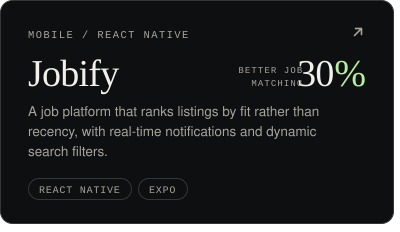</a><a href="https://www.abhijat.co.in/">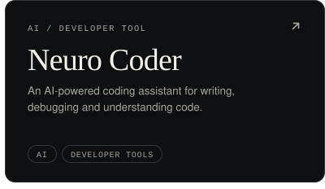</a>
<a href="https://github.com/Abhijat-Abhijat/coding-session-tracker">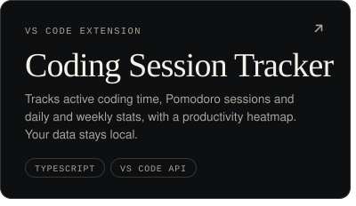</a><a href="https://github.com/Abhijat-Abhijat/multiAgentPOC">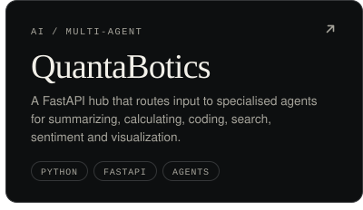</a>

<a href="https://abhijat-abhijat.github.io/Abhijat-Abhijat/game/"></a>

A recording of the game's autopilot. Click it to take the controls.

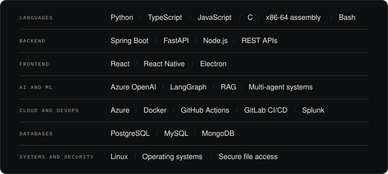





<a href="https://www.abhijat.co.in/"></a>
