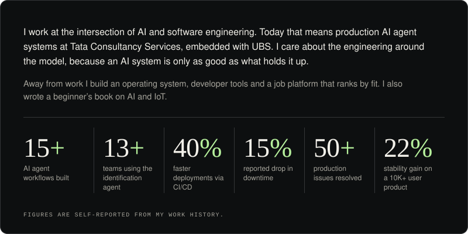
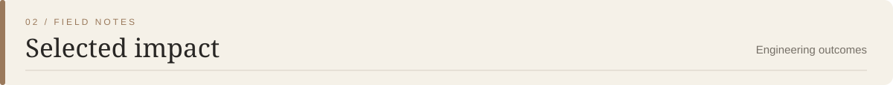
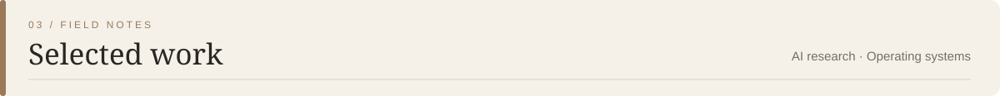
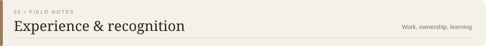
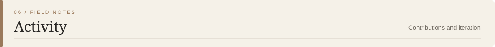
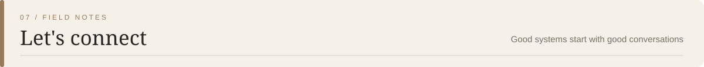

  

  

  <em>Engineering intelligence. Building systems that scale.</em>

I'm a **Full-Stack Software Engineer focused on AI and agent systems, backend engineering, and cloud-native applications.**

My work spans multi-agent LLM workflows, backend services, observability, and CI/CD automation. I currently work at **Tata Consultancy Services on a UBS client engagement**, building AI-driven workflows and engineering tools.

| Engineering focus | Reported outcome |
|---|---:|
| AI agents built and deployed | 15+ |
| Teams adopting an identification agent | 13+ |
| Faster deployments through CI/CD automation | 40% |
| Reduction in system downtime | 15% |
| Production issues resolved | 50+ |
| Stability improvement for 10K+ monthly users | 22% |

Reported outcomes from my existing profile README; these are project-specific figures, not independently audited metrics.

### 01 / AI Research Scientist Agent

A multi-agent system for AI research automation, coordinating five agents for orchestration, prompt engineering, and collaborative AI workflows.

`Python` `LangGraph` `HTML` `GitLab Pages`

[Explore my repositories →](https://github.com/Abhijat-Abhijat)

### 02 / ASH OS

A lightweight Linux distribution built from scratch, focused on boot performance and hardened file-access policies.

`Bash` `Linux From Scratch` `Wine` `Bottles`

[Explore my repositories →](https://github.com/Abhijat-Abhijat)

  
  
  
  
  
  
  
  
  
  
  
  
  
  
  

### Assistant Software Engineer — Tata Consultancy Services
*UBS client engagement · Pune · June 2024–Present*

- Designed multi-agent AI pipelines, including prompt engineering and workflow coordination.
- Built reusable Python utilities adopted across teams.
- Developed an identification agent adopted by 13+ teams.
- Automated CI/CD pipelines, reducing deployment time by 40%.
- Developed Splunk dashboards associated with a 15% reduction in downtime.

### Full Stack Developer — TCI
*HerHeadquarters and Mud Australia · Delhi · November 2022–November 2023*

- Improved application stability by 22% for 10,000+ monthly users.
- Resolved 50+ production-impacting issues.
- Improved CI/CD workflows, reducing build times by 30%.

### Recognition

- Silver Medal — B.Tech academic year 2022–23, SRM University Delhi NCR (SGPA 9.1)
- Star of the Month — Tata Consultancy Services
- On The Spot Award — Tata Consultancy Services
- DIAT Certified — DRDO, Pune

  
  

  <picture>
    <source media="(prefers-color-scheme: dark)" srcset="https://raw.githubusercontent.com/Abhijat-Abhijat/Abhijat-Abhijat/output/github-snake-dark.svg">
    <source media="(prefers-color-scheme: light)" srcset="https://raw.githubusercontent.com/Abhijat-Abhijat/Abhijat-Abhijat/output/github-snake.svg">
    
  </picture>

  

  Thoughtful engineering. Intelligent systems. Continuous iteration.

